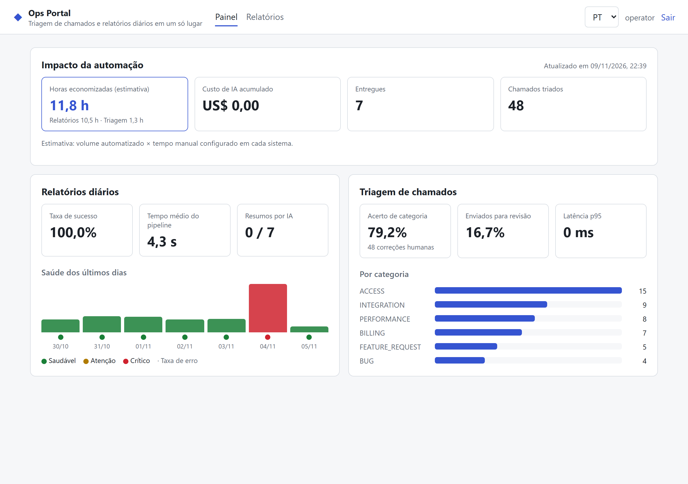
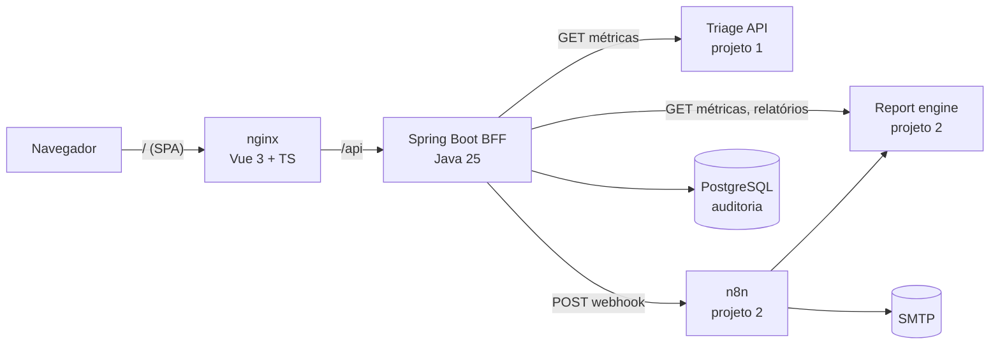

# Ops Portal


Portal interno que junta, numa tela só, os resultados das duas automações do portfólio e
deixa um operador **rodar o relatório diário sob demanda**:

- [**ticket-triage-agent**](https://github.com/Giulia-Castro/ticket-triage-agent): agente de IA que tria chamados de suporte;
- [**ops-report-automation**](https://github.com/Giulia-Castro/ops-report-automation): pipeline n8n que gera e envia o relatório diário de operações.

**Demo ao vivo:** https://giulia-castro.github.io/ops-portal/ (somente leitura, com dados
exportados da stack real pelo CI a cada deploy)



---

## O que o portal resolve

Cada automação tem sua própria API de métricas, mas quem gerencia a operação quer uma
resposta só: **quanto tempo as automações estão economizando, quanto custam e se algo precisa
de atenção hoje**. O portal responde isso e ainda substitui o "pede pra alguém rodar o
relatório de ontem de novo" por um botão com controle de acesso e trilha de auditoria.

| Na tela | De onde vem |
|---|---|
| Horas economizadas (total, relatórios, triagem) | Volume automatizado de cada sistema × tempo manual configurado |
| Custo acumulado de IA | Soma do custo de tokens dos dois sistemas |
| Saúde dos últimos 30 dias (verde/amarelo/vermelho) e taxa de erro diária | Relatórios do pipeline n8n |
| Acerto da triagem, taxa de revisão humana, latência p95, volume por categoria | Agente de triagem, com acerto medido por feedback humano |
| Rodar relatório de um dia, com histórico de quem rodou, quando e o resultado | Webhook do n8n + auditoria no PostgreSQL do portal |

## Resultados medidos

Stack real (os três projetos) alimentada com os dados de exemplo de cada um:

| O quê | Resultado |
|---|---|
| Chamados triados (48 do dataset rotulado do P1) | **79,2%** de acerto de categoria, medido pelo feedback humano gravado via API |
| Relatórios diários | 7 dias entregues, 1 crítico (incidente de billing em 04/11) |
| Regras de negócio pela API real | dia já entregue → `409`; viewer tentando rodar → `403`; n8n fora do ar → `503` com a tentativa auditada como `UNAVAILABLE` |
| Testes | backend: 30 testes, **98%** de cobertura de linhas (domínio e aplicação em 100%); frontend: 6 testes |

O CI repete isso a cada push: sobe os três projetos com Docker Compose, popula os dados, roda
um relatório **pelo portal** como operador (o n8n executa o workflow e envia o e-mail) e
confere o painel. Os dados da demo publicada saem dessa execução.

> As horas economizadas são **estimativas**: 90 min por relatório e 2 min por chamado são
> hipóteses configuráveis (`MANUAL_REPORT_MINUTES`, `TRIAGE_MANUAL_MINUTES`). Cronometre o
> processo manual da sua equipe antes de divulgar o número.

---

## Arquitetura



**Por que um BFF (backend for frontend):** as chaves de API dos outros sistemas ficam no
servidor, nunca no navegador. O BFF também junta as duas fontes num único payload, aplica
controle de acesso por perfil e registra quem disparou cada relatório.

```
backend/src/main/java/.../opsportal/
├── domain/          # Dashboard, ReportRun, ReportRunPolicy, Result. Sem Spring.
├── application/     # Casos de uso e portas (TriageGateway, ReportGateway, ReportTrigger).
├── infrastructure/  # Clientes HTTP (timeout, retry, circuit breaker) e JPA.
├── web/             # Controllers, RFC 7807 com i18n (en/pt-BR), correlationId.
└── config/          # Composição, segurança, propriedades.
frontend/src/        # Vue 3 + TypeScript, vue-router, vue-i18n (en/pt-BR).
```

### Decisões de projeto

| Decisão | Por quê |
|---|---|
| **Degrada em vez de quebrar** | Se um sistema não responde, o painel mostra o outro e marca o total como parcial. Um sistema fora do ar não derruba o portal. |
| **Retry só em leitura** | GETs têm retry e circuit breaker. Disparar o relatório **não** tem retry, porque rodar duas vezes enviaria dois e-mails. |
| **Regra antes do n8n** | Dia já entregue, dia futuro ou fora da janela são recusados pelo domínio antes de chamar o workflow. Só um relatório roda por vez. |
| **Falha do workflow é resultado, não erro** | Se o n8n roda e falha, a execução fica registrada como `FAILED`, e o workflow de erro do n8n já alertou o plantão. n8n inacessível vira `503` e também fica auditado. |
| **Sessão + CSRF por cookie** | Login com sessão HttpOnly e token CSRF em cookie (double-submit). Sem token no `localStorage`. |
| **Negar por padrão** | Rotas não mapeadas retornam `403`. Contas sem senha configurada não são criadas. |
| **Demo estática honesta** | O GitHub Pages serve o mesmo front com os dados exportados pela stack real no CI. Ações desativadas e aviso visível. |

## Segurança e LGPD

- O portal só trafega **métricas agregadas**: nenhum texto de chamado, e-mail ou log bruto. Os sistemas de origem já mascaram dados pessoais.
- Perfis: `viewer` (leitura) e `operator` (pode rodar relatórios), com senhas só em variável de ambiente e guardadas com BCrypt em memória.
- Auditoria de cada execução: `requestedby`, horários, resultado, colunas `createdat/by`, `updatedat/by` e `rowversion` (lock otimista).
- Cabeçalhos de segurança no nginx (CSP, `X-Frame-Options`, `nosniff`). Portas expostas só em `127.0.0.1`.
- Logs estruturados (ECS/JSON) com `X-Correlation-ID` propagado para as APIs de origem e o n8n.

---

## Como rodar

Clone os três repositórios lado a lado:

```bash
git clone https://github.com/Giulia-Castro/ticket-triage-agent.git
```
```bash
git clone https://github.com/Giulia-Castro/ops-report-automation.git
```
```bash
git clone https://github.com/Giulia-Castro/ops-portal.git
```

Dentro de `ops-portal`, gere os segredos e suba tudo (o arquivo inclui o compose do projeto 2):

```bash
cd ops-portal
```
```bash
bash scripts/generate-env.sh
```
```bash
docker compose up -d --build
```

Popule com os dados de exemplo dos dois projetos (48 chamados e 7 dias de relatórios):

```bash
bash scripts/seed.sh
```

| O quê | Onde |
|---|---|
| Portal | http://localhost:8080 (usuários `viewer` e `operator`, senhas no `.env`) |
| E-mails enviados (Mailpit) | http://localhost:8025 |
| n8n | http://localhost:5678 |

No portal, entre como `operator`, vá em **Relatórios** e rode o dia **06/11/2026**: o n8n
executa o workflow, o e-mail chega no Mailpit e a execução aparece no histórico.

### Desenvolvimento

```bash
cd backend && mvn verify          # Java 25 + Maven
```
```bash
cd frontend && npm ci && npm run dev    # proxy de /api para localhost:8080
```
```bash
cd frontend && npm run dev:demo         # front com os dados de public/demo
```

## CI/CD

[`.github/workflows/ci.yml`](.github/workflows/ci.yml):

1. **backend**: testes e cobertura mínima de 80% em domínio e aplicação (JaCoCo);
2. **frontend**: typecheck, testes (Vitest) e build;
3. **e2e**: faz checkout dos três repositórios, sobe a stack completa, popula, roda um relatório pelo portal e confere o painel ([`scripts/e2e.sh`](scripts/e2e.sh));
4. **pages**: em push na `main`, publica a demo no GitHub Pages com os dados exportados pelo passo 3.

## Limitações e próximos passos

- Contas fixas (`viewer`, `operator`). Em produção, trocar por SSO (OIDC) da empresa.
- Migration escrita para PostgreSQL. Oracle e SQL Server precisam de scripts próprios em `db/migration/{vendor}`.
- O bloqueio de execução simultânea é por instância. Com várias réplicas, usar lock no banco.
- A janela de "últimos dias" lê até 30 relatórios. Para histórico longo, paginar na API do projeto 2.

## Licença

[MIT](LICENSE)
